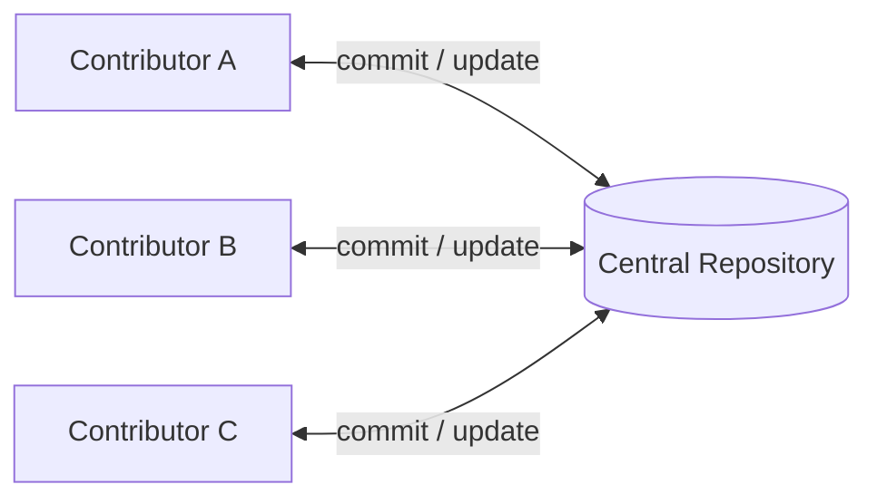
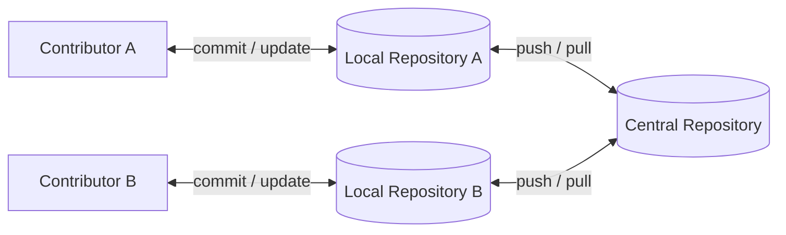

# This is Circle 6

Our Summary of our Month 1 Learnings at AltSchool Africa

<div @click="$slidev.nav.next" class="mt-12 py-1" hover:bg="white op-10 c">
  Meet the Circle <carbon:arrow-right />
</div>

<div class="abs-br m-6 text-xl">
  <button @click="$slidev.nav.openInEditor()" title="Open in Editor" class="slidev-icon-btn">
    <carbon:edit />
  </button>
  <a href="https://github.com/slidevjs/slidev" target="_blank" class="slidev-icon-btn">
    <carbon:logo-github />
  </a>
</div>

---
layout: center

---

# An Introduction to Software Engineering

<p class="text-sm mt-4">
Presented by <b>Waheed Oladunjoye</b> and <b>Oyebode Treasure Amaka</b>
</p>

<footer class="mt-20 text-sm">
Authored by : <!--Input authors here-->

</footer>
<!-- Intro : Software Engineering, importance, Algorithms, problem solving, intro to web development -->

---
layout: center

---

## What is Software Engineering?

<div class="text-sm">

<p v-click>
Software engineering is the branch of computer science that deals with designing, building, testing and maintaining software. Coding is only one part. The bigger part is solving the right problem in a way others can understand and maintain.
</p>

<p v-click class="mt-4">
Anyone can write a program that works once on their laptop. Engineering is making it work reliably, for many users, over years. It's the difference between cooking at home and running a restaurant.
</p>

</div>

---

## Types and Why It Matters

<div class="text-sm">

<v-clicks>

* **Web and apps:** front-end, back-end, full-stack and mobile engineers
* **Systems:** embedded, DevOps and security engineers
* **Data and quality:** data engineers, scientists and test engineers

</v-clicks>

<p v-click class="mt-4">
It matters because it drives innovation, keeps software safe and reliable, automates work, connects people, and lets businesses grow.
</p>

</div>

---

## Problem Solving and Algorithms

<div class="text-sm">

<p v-click>
Before writing code, ask: <b>what exactly is the problem?</b> Understand it, break it into small pieces, plan the steps, then test and improve.
</p>

<p v-click class="mt-4">
An <b>algorithm</b> is a step-by-step set of instructions for solving a problem, like a recipe for a computer: <b>Input</b> → <b>Steps</b> → <b>Output</b>.
</p>

<p v-click class="mt-4">
A good one is clear, finishes, gives the right answer every time, and doesn't waste time or memory.
</p>

</div>

---

## Types of Algorithms

<div class="text-sm">

<v-clicks>

* **Searching:** finding a contact on your phone
* **Sorting:** arranging products by price on Jumia
* **Routing:** Google Maps finding the shortest route
* **Text:** spell-check and Google search
* **Math:** a bank app working out interest

</v-clicks>

</div>

---

## Measuring It: Big-O

<div class="text-sm">

Big-O tells us how an algorithm's time and memory use grow as the data grows.

<v-clicks>

* **O(1), very fast:** picking up the top book on a table
* **O(n), normal:** checking every student in a class one by one
* **O(n²), slow:** comparing every student to every other student

</v-clicks>

</div>

---

## The Software Development Life Cycle (SDLC)

<div class="text-sm">

**Understand** → **Design** → **Build** → **Test** → **Deploy** → **Maintain**

<p v-click class="mt-4">
It's a loop, not a straight line. Software is never really finished.
</p>

</div>

---

## Habits Worth Building Early

<div class="text-sm">

* Break big problems into small ones
* Write code others can read
* Use Git from day one
* Test your work
* Keep learning, because tools change but fundamentals don't

<p v-click class="mt-4">
Software engineering isn't about knowing everything. It's about solving problems carefully, one small step at a time.
</p>

</div>

---
layout: center

---

# How the web works

<!-- Introduction to html : CSS and JS mentioned, but not emphasized -->
<div v-click class="text-center">
<p>An Introduction to HTML</p>

<p class = "mt-15">
Authored by : Bethel Amadi.</p>
</div>
---

# HTML: The Structure of a Webpage

<div class="text-sm leading-7">

HTML (HyperText Markup Language) is the standard language used to create and structure webpage content. It organizes headings, paragraphs, links, images, audio, and video so browsers can display them.

<p v-click class="mt-4">
Think of a webpage as a house: HTML provides the rooms and walls, CSS adds the colours and layout, and JavaScript adds actions and interaction.
</p>

```html
<h1>Welcome to My Website</h1>
<p>This is my first webpage.</p>
```

<p v-click>
The <code>&lt;h1&gt;</code> element displays a main heading, while <code>&lt;p&gt;</code> displays a paragraph.
</p>

</div>

---

## Tags and Elements

<div class="text-sm leading-7">

HTML tags are keywords inside angle brackets that tell the browser how to structure content. An element usually has three parts:

<ul class="list-disc list-inside text-left mx-auto max-w-xl">
  <li><strong>Opening tag:</strong> marks where the element begins</li>
  <li><strong>Content:</strong> the information displayed on the page</li>
  <li><strong>Closing tag:</strong> marks where it ends; it includes a slash</li>
</ul>

```html
<p>This is an HTML paragraph.</p>
```

<p v-click class="mt-4">
Here, <code>&lt;p&gt;</code> is the opening tag, the sentence is the content, and <code>&lt;/p&gt;</code> is the closing tag. Together, they form a paragraph element.
</p>

</div>

---

## Attributes: Name and Value

<div class="text-sm leading-7">

Attributes add information or functionality to an element. They are written in the opening tag, usually as a name followed by a value.

```html
<a href="https://www.google.com">Visit Google</a>

```

<ul class="list-disc list-inside text-left mx-auto max-w-xl">
  <li>In the link, <code>href</code> is the attribute name and the URL is its value; the text is what visitors see.</li>
  <li>In the image, <code>src</code> gives the image location and <code>alt</code> describes it.</li>
</ul>

</div>

---

## Nested and Void Elements

<div class="text-sm leading-7">

Nested elements sit inside other elements to create a logical content hierarchy. The outer element is the <strong>parent</strong>; elements inside it are <strong>children</strong>.

```html
<div>
  <h2>About Us</h2>
  <p>Welcome to our website.</p>
</div>
```

<p v-click>
The <code>div</code> is the parent; the heading and paragraph are its children. Close nested elements in the reverse order they were opened.
</p>

<p v-click class="mt-3">
Void elements have no content and do not use closing tags. They cannot contain other elements.
</p>

```html

<br>
<hr>
<input type="text">
```

</div>

---

## Basic HTML Document Structure

<div class="text-sm leading-7">

The document follows a standard arrangement so the browser can interpret its metadata and page content.

```html
<!DOCTYPE html>
<html lang="en">
  <head>
    <meta charset="UTF-8">
    <meta name="viewport" content="width=device-width, initial-scale=1.0">
    <title>My First Website</title>
  </head>
  <body>
    <h1>Welcome to My Website</h1>
    <p>This is my first HTML document.</p>
  </body>
</html>
```

<ul class="list-disc list-inside text-left text-xs mx-auto max-w-2xl">
  <li><code>&lt;!DOCTYPE html&gt;</code> declares an HTML5 document; <code>&lt;html&gt;</code> contains the whole page.</li>
  <li><code>&lt;head&gt;</code> holds metadata: character encoding, the viewport setting for different screen sizes, and the browser-tab title.</li>
  <li><code>&lt;body&gt;</code> holds the visible page content. The <code>lang</code> attribute identifies the page language.</li>
</ul>

</div>

---

## Images: `img`, `src`, and `alt`

<div class="text-sm leading-7">

The <code>&lt;img&gt;</code> element displays an image. Its <code>src</code> attribute gives the file path; <code>alt</code> provides a text alternative if the image cannot load and for screen-reader users.

```html

```

<p v-click class="mt-4">
The optional <code>width</code> and <code>height</code> attributes set image dimensions. Write meaningful, concise alt text for informative images; use <code>alt=""</code> when an image is purely decorative.
</p>

</div>

---

## Audio: Embedding Sound

<div class="text-sm leading-7">

The <code>&lt;audio&gt;</code> element embeds music, recordings, and other sound files. A nested <code>&lt;source&gt;</code> identifies the file and its format.

```html
<audio controls>
  <source src="music.mp3" type="audio/mpeg">
  Your browser does not support audio playback.
</audio>
```

<ul class="list-disc list-inside text-left mx-auto max-w-xl">
  <li><code>controls</code> displays play, pause, and volume controls for listeners.</li>
  <li><code>src</code> gives the media location; <code>type</code> tells the browser its format.</li>
  <li>The text inside the element is fallback content for browsers that do not support audio.</li>
</ul>

<p v-click class="text-sm">Other useful audio attributes include <code>loop</code> (repeat playback), <code>muted</code> (start silent), and <code>preload</code> (hint how to load the file).</p>

</div>

---

## Video: Sources, Posters, and Captions

<div class="text-sm leading-7">

The <code>&lt;video&gt;</code> element plays video in the browser. <code>controls</code> gives viewers playback controls, and <code>&lt;source&gt;</code> specifies the file and format.

```html
<video controls width="600" poster="thumbnail.jpg">
  <source src="tutorial.mp4" type="video/mp4">
  <track
    src="captions.vtt"
    kind="captions"
    srclang="en"
    label="English"
    default
  >
  Your browser does not support video playback.
</video>
```

<ul class="list-disc list-inside text-left mx-auto max-w-xl">
  <li><code>poster</code> shows a preview image before playback starts.</li>
  <li><code>&lt;track&gt;</code> adds timed text; its <code>src</code> points to the caption file, <code>kind</code> sets its type, and <code>srclang</code> and <code>label</code> identify its language.</li>
  <li>Captions include dialogue and relevant sounds; subtitles usually provide dialogue or its translation. Both can help viewers follow the video.</li>
</ul>

</div>

---

## From HTML Structure to JavaScript Behavior

<div class="text-sm leading-7">

HTML gives content its structure. CSS controls how that content looks and is arranged. JavaScript makes the page respond to actions and change over time.

<p v-click class="mt-4">
Now that we have seen how HTML describes a webpage, let's move from its structure to the behavior that makes it interactive.
</p>

</div>

---

layout: center

---

# What is HTML?

<p v-click class ="text-sm">
HTML (or Hypertext Markup Language) is the standard markup language for creating and structuring content on the web. It's one of the pillars for applications built on the web and it is used to create elements such as headers, footers, paragraphs, tables, forms, etc.
</p>

<p v-click class="text-sm mt-[10px]">
Is it a programming language? No. That's because it actually doesn't perform locical computations or execute programming instructions. Instead it can structure and manipulate web pages by using tags, elements and attributes telling web browsers what content should be displayed and how to organize it.</p>
---

## Layout of a traditional HTML Document

```html
<DOCTYPE html> <!--Tell the browser..."this is a html document and it uses hmtl 5"-->

  <html lang="en">
    <head>
      <!-- information about the web page lives inside here...things such as the meta data, title, linked style sheets and scripts, linked fonts etc. -->
    </head>

    <body>
      <!-- this is what the browser renders, elements go in here for example...-->

       <p>This is my first web page.</p>
    </body>
  </html> <!--This is an html tag, everything concerning the html document lives inside this tag-->
```

---

# HTML Tags and Elements

<div v-click class="text-sm">
Tags and elements are the building blocks of html elements, especially in the body. They allow the proper structuring of a web page and it's content. Elements are made up of tags and their content which goes inside the tag, some which may have opening and closing tags, others may just have one tag which self closes.
<br>
For example, navigation bars could go in the <span class="text-red">header</span> tag, or if you wanted to put it in a sidebar you could use the <span class="text-red">aside</span> tag..I like to think of html as a base language, and it can do very good things for you when you can use it simply...but when you can make use of semantic html, it's way more powerful because it can simplify tricky page structures and designs.

<p class="text-sm mt-10">
HTML elements can also have attributes, some which describe them, others allow them to reference files, links or values even. These can help and also impact the way elements behave</p>

```html
<h2 class="header-2">This is a header element</h2> <!--This is an element, with it's h2 tag and it's content(which can be empty) and it's class attribute-->
```

<p class="text-sm">
HTML on it's own is a powerful tool..It's able to perform and simplify tedious tasks on the web by using some nifty elements but HTML on it's own isn't complete. So let's take a look at the pillars of web development that complete web development aside HTML.</p>
</div>

---

## CSS and Javascript

<p v-click>
HTML, CSS and Javascript are the three fundamentals used to create modern web applications. Each of them have a different responsibility but they come together to produce powerful, attractive and interactive digital experiences for users. So what does each do?

<div class="text-sm mt-3.5">
 <ul class="flex flex-col gap-1.5">
 <li>
 HTML provides structure by defining what exists on the page and how it's organized. For example, you can use html to create a login form with fields for name, address, delivery options etc. But by itself HTML does not provide styling or advanced interactive behavior to make that form look good, or submit.</li>

  <li>
 Cascading style sheets allows us to use simple and sophisticated styling to beautify our web pages. It determines colors, spacing, fonts, borders, backgrounds, animations, positioning, responsive layouts etc. CSS can transform our basic form from before into a polished visual interface. It heavily impacts web development and usage of web applications by transforming the user experience between different screen sizes or devices. Snappy animations, beautiful transitions etc. all play a role in making the overall feel of a web page more than just words and images.</li>

 <li>
 The feel we said CSS brings to a web page? Javascript dials that up by adding behaviour and interactivity. It allows the web page to come alive...literally. It makes web applications functional and dynamic, it can execute logic, process data and respond to user actions on the web page. For example, when the user wants to submit our form from before, Javascript can validate, collate results into an object and also send HTTP requests over the web to APIs and databases. It is an extremely powerful pillar that takes web pages from static documents to dynamic tools that run the web.
 </li>
 </ul>
</div>
</p>
---
layout: center

---

# Let's talk about Javascript

<footer v-click class="mt-20 text-sm">
Authored by : Elemi Samuel and Blessing Dawodu.
</footer>
---
layout: center

---

<h1>
What is Javascript?
</h1>

<div v-click class="mt-5">
Javascript is a fundamental building block for web-powered applications. It is the backbone for webpages, and serves as the main provider of application functionality that makes web apps usable, interactive, reliable and intuitive.
</div>

---

## JavaScript and the web

<div class="text-sm">
HTML gives the web page structure and CSS allows styling. Javascript(also referred to as JS) delivers interactivity, it translates problem solving logic and it serves functional behavior to the web page--allowing sites to move beyond static text or designs and respond to user actions as they happen. Let's look at a brief example of what it looks like, then we can start on the javascript basics.

```js
// brief example of javascript code
console.log('This is Elemi Samuel Speaking...')

const color = 'blue'
```

</div>

---

## Variables in Javascript

<p class="text-[14px]">
A variable is a container used for storing data. Think of your RAM as a kitchen, various dishes need cooking and there are various ingridients present within said kitchen all at the same time...well, your variable in this analogy would be a container used to house said ingridient and is saved within the kitchen (memory) so it can be used within a certain context. In javascript, these variables need to be <em>declared</em> in order to be able to house data inside them...and to do this you can either use the <span class="text-purple my-[5px]">let</span>, <span class="text-purple my-[5px]">const</span> or  <span class="text-purple my-[5px]">var</span> keywords to declare a variable.</p>

---

## Naming Variables

<div class="text-sm">

Javascript also has a couple of rules guiding variable names that we have to follow. They are :

* the first character must be a digit
* reserved words or keywords cannot be used as variable names
* if it contains multiple words, use **Camel case**
* if possible use variable specific names, prefferably ones that describe what the specific variable will be housing, also stay away from easily reusable names such as single letters(a, b ,c) or short alphanumeric names(a1, a3, z5)
* you can separate multiple words using the underscore(_), but camelCasing should be the first naming convention at hand.

```js {monaco-run}{autorun: false}
let name  //This is how to declare a variable
name = "Theresa" //Variable definition...This tells Javascript to put "Theresa" inside of the container 'name'
// console.log(name) 
var age = 18 //you can also declare and define in the same line, telling js to make a container 'age' and put "18" in that container all at once
console.log(age)

```
<!-- The nitty gritty : Most programming languages actually treat variables as references to a memory address, whether that's as a pointer or as a direct reference to it's memory address. So yes, you can think of a variable as a container, but under the hood the container itself is a slot in memory, the variable itself is just a reference to it...so when you call a variable, remember you're only referencing a memory address which contains the data you're storing. -->
</div>

---

<div class= "text-sm flex flex-col gap-5">
<h3>Variable use : <span class="text-cyan">const</span></h3>

* Variables declared with const are **constant** values and for that reason, their value cannot be altered after definition.
* For values that could change, it's best practice not to use const.

<h3 class = "text-sm">Variable use : <span class="text-cyan">let</span> and <span class="text-cyan">var</span></h3>

* As opposed to <span class="text-purple-400">const</span>, variables defined using <span class="text-purple-400">let</span> and  <span class="text-purple-400">var</span> allow reassignment of values.

```js{monaco-run}{autorun:false}
const sam = "Elemi Samuel"
console.log(sam)
// sam = "Munachi" //This won't work because sam has already been assigned a value as a constant variable. 

let name = "Oluwasetemi"
console.log(name)
name = "Munachi"
console.log(name) //name changed and "Munachi" prints
```

</div>
---

# Data Types

<p v-click>
A value in JS has to be of a certain data type. The data type defines the operations a variable can do and also what methods can act upon it
</p>
<div v-click class = "text-sm">

<span class = "text-red-400">Number</span>

* A number in javascript can be an integer or a floating point, both fall under the <span class = "text-red-400">Number</span>
 umbrella.

```js{monaco-run}{autorun: true}
const age = 20 //integer
const floatingPoint = 14.458 //floating point
console.log(typeof floatingPoint)
console.log(typeof age)
```

</div>

---

# Data Types (cot'd)

<div v-click class = "text-sm">

* A <span class = "text-red-400">String</span> must be surrounded by air quotes, that could be back ticks, single or double quotes.

```js{monaco-run}{autorun: true}
const myName = "Elemi Samuel" // ✅ good practice
const myName2 = `Elemi Samuel` // ✅ good practice
const name  = "Elemz' // ❌ bad practice
//in summary, ensure you stay consistent in what quotes you use to open and close a string
```

* The <span class = "text-red-400">Boolean</span> type only consists of two possible values...true and false.

```js{monaco-run}{autorun: true}
const bool = true
const isEligible = false
```

</div>

---

## Data Types (continued)

<div v-click class = "text-sm">

* An <span class = "text-red-400">Object</span> type is a collection of keys and values used to store collections of data.

```js{monaco-run}{autorun: true}
const person = {name : "Ebere", age : 25, degree: true, school : "SOE"}
```

* The <span class = "text-red-400">undefined</span> type is reserved for variables that have not been assigned a value
* The <span class = "text-red-400">null</span> type is a special value that represents an empty variable.

</div>

---

There's actually an unresolved flaw in Javascript dating back years

<div v-click class="text-sm">

* The <span class = "text-red-400">null</span> type actually returns an object type.

```js{monaco-run}{autorun: true}
const name = null
console.log(typeof name)
```

<p>It originates from how data types were stored in the first place, with the object and null types sharing type tags that were slightly similar and hence misclassified by the typeof operator.</p>
</div>

<p v-click class="text-sm">Can this be resolved? of course. But it would break many legacy websites and libraries that rely on this tiny hiccup...so it remains the flaw of Javascript that has grown to be beautiful I guess 🤷🏽‍♂️ </p>

---

# What is Control Flow?

<p class="text-[16px]">
Control flow determines the order in which instructions/statements execute. If a script does not include statement that alter it flow, its executed from beginning to the end (top - bottom). JavaScript programs commonly use these three approaches:
</p>

* **Sequence:** Executes instructions in order
* **Selection:** Choose which instruction to execute
* **Iteration:** Repeates instructions

```js
console.log('Wake up');
console.log('Brush your teeth');
console.log('Eat breakfast');
```

<p>JavaScript executes these statement from top to bottom. First, wake up; then brush your teeth; finally, eat breakfast.</p>

<!-- 
  But what if you don't have a toothbrush? Or what if you want to repeat brushing your teeth every morning?
  We need a way to make decisions and repeat instructions. That's where control flow structures come in.
-->

---

## Conditionals

<p class="text-base mt-3">
Conditional statements determine whether code should be execute based on one or two conditions. The conditional statement execute the code, if the associated conditions are <span class = "text-red-400">true </span>
</p>

<p>In JavaScript there are different types of conditionals depending on the problem you intend to solve. Common conditional statement includes:</p>

* `if`
* `if...else`
* `Multiple if...else`
* `?: ternary operator`
* `switch`

<p><span class = "text-red-600">Note</span>: Conditional are very important in JavaScript and all other programming language. It helps with making informed decisions based on the problem faced</p>

---

### The `if` statement

<div v-click class="text-sm">
<P>An `if` statement execute a block of code when the condition is true.</P>

* **Syntax**:

```js
if (condition) {
//  block of code to be executed
}
```

<p class="mt-10"></p>

```js {monaco-run}{autorun: false}
let age = 20;

if (age >= 18) {
console.log ("You're an adult");
}
```

<p>If the  condition is false, the block of code is skipped</p>
</div>

---

### The `if...else` statement

<div v-click class="text-sm">
<p>Uses `else` to provide an alternative when the `if` the condition is false</p>

* **Syntax**:

```js
if (condition) {
//  block of code to be executed if code is true
} else {
// block of code to be executed if code is false
}
```

<p class="mt-10"></p>

```js {monaco-run}{autorun: false}
const isLoggedIn = false;

if (isLoggedIn) {
console.log ("Welcome back!");
} else {
  console.log ("Please log in.");
}
```

</div>

<p class="mt-10"></p>

### The `Multiple if...else` statement

<div v-click class="text-sm">
<p>The `multiple if...else` also called `else if` statement is used to check multiple conditions</p>
</div>

---

<div>

* **Syntax**:

```js
if (condition) {
//  block of code to be executed if code is true
} else if {
// block of code to be executed if first condition is false and the second condition is true
} else {
// block of code to execute if first and second condition is false
}
```

<p class="mt-10"></p>

```js {monaco-run}{autorun: false}
const score = 75;

if (score >= 80) {
console.log ("Grade A");
}else if (score >= 70) {
  console.log ("Grade B");
}else if (score >= 60) {
console.log ("Grade C");
}else {
  console.log ("Try again.");
}
```

<p> JavaScript executes the first maching conditions and skips the remaining conditions.</p>
</div>

---

### Trenary Operator: `?:`

<div v-click class="text-sm">
<p>The ternary operator `?:` is also a conditional statement that operate on three values. A simpler way of writing an `if...else` statement</p>

* **Syntax**:

```js
**condition ? expression_if_true : expression_if_false**
```

<p class="mt-10"></p>

```js {monaco-run}{autorun: false}
let age = 20;

let canVote = (age > 18) ? true : false 
console.log (canVote);

```

</div>

<p class="mt-10"></p>

### The `Switch` Statement

<div v-click class="text-sm">
<p>A `switch` statement compares an expression against different case values.</p>

<p>`break` prevents execution from falling through to the next case.</p>
<p>`default` runs when no case matches.</p>

</div>

---

<div>

* **Syntax**:

```js
switch (expression) {
    case value1:
        // Code to execute if expression matches value1
        break;
    case value2:
        // Code to execute if expression matches value2
        break;
    default:
        // Code to execute if no cases match
}

```

<p class="mt-5"></p>

```js {monaco-run}{autorun: false}
const day = 'Monday';

switch (day) {
  case 'Monday':
    console.log('Start of the week');
    break;
    case 'Wednesday':
      console.log('The week is divided');
      break;
      case 'Friday':
        console.log('The weekend is upon us');
        break;
        default:
          console.log('Another day');
}
```

</div>

---

# Loops

<p class="text-xs">
Loops let you repeat a set of statement for as long as the condition is met, or until a condition is met.
</p>

<div class="mt-3"> Types of Loops

* **while loop**
* **do...loop**
* **for loop**
* **for...of loop**
* **for...in loop**

</div>

## The `while` loop

<div v-click class="text-sm">
<p>A while loop repeats as long as its condition is true</p>

* **Syntax**:

```js
while (condition) {
  // Code block to execute repeatedly
  // Must include a way to update the condition (e.g., i++)
}

```

</div>

---

## The `while` loop: example

```js {monaco-run}{autorun: false}
let count = 1
while (count <= 3) {
  console.log(count);
  count++;
}
```

---

## The `do...while` loop

<div v-click class="text-sm">
<p>A `do...while` loop executes the body of the code at least once before checking the condition</p>

* **Syntax**:

```js
do {
    // code block to be executed
} while (condition);

```

```js {monaco-run}{autorun: false}
let number = 5;

do {
  console.log(number);
} while (number < 5);
```

<p>Note: Even though the condition is initially false, the body still execute once</p>
</div>

---

## The `for` loop

<div v-click class="text-sm">
<p>A for loop is useful when you know the number of time you wan the code to run</p>

* **Syntax**:

```js
for (initialization; condition; update) {
    // code to be executed
}

```

```js {monaco-run}{autorun: false}
for (let i = 1; i <= 5; i++) {
  console.log(i);
}
```

<p>Everything inside the parentese gets executed as long as the condiion is met</p>
<p>Note: There's a difference between `< and <=`</p>

</div>

---

## The `for...of` loop

<div v-click class="text-sm">
<p>The `for...of` loop is used to loop over iterable properties. An iterable property is an element or object that has countable value e.g Array, string, map, set</p>

* **Syntax**:

```js
for (const element of iterable) {
  // code to be executed
}

```

```js {monaco-run}{autorun: false}
const fruits = ['Pawpaw', 'Orange', 'Pineapple', 'Banana'];

for (const fruit of fruits) {
  console.log(fruit);
}
```

</div>

---

## The `for...in` loop

<div v-click class="text-sm">
<p>The `for...in` loop is used to loop or iterate over enumberable property of an object</p>

* **Syntax**:

```js
for (let key in object) {
  // code to be executed
}

```

<p class="mt-10"></p>

```js {monaco-run}{autorun: false}
const student = {
  name: 'Blessing',
  learnerID: 'SEO123',
  faculty: 'fullstack engineering'
};

for (const key in student) {
  console.log(key)
}
```

</div>

---

# Functions

<p>
A Function is a resuable block of code written to perform a particular task (it can be called many times).
</p>

<div class= "text-sm">

### Important things to note before declaring a function

* The function keyword is written first
* The fnction name follows
* A list of parameter (if any) is enclosed in parentheses.
* The function body, containing the code to be executed, is enclosed in curly braces.
* To execute the code, function must be called by its name followed by parentheses.

### Importance of Functions

* It helps avoid unnnecessary code repitition
* Organizes code into smaller units
* Accept inputs and produce results
* Makes programs easier to maintain

</div>
---

### Function without parameters

* **Parameters:** Are variables listed in a funcion definition.

* **Arguments:** Are the actual values passed when calling the function

* **Function declaration Syntax**:

```js
function name(parameter1, parameter2, ...parameterN) {
  // code to be executed
}
```

```js {monaco-run}{autorun: false}

function sum () {
  let result = 10 + 10
  console.log(`The result is: ${result}`)
}
sum();

```

---

### Function with Parameters

```js {monaco-run}{autorun: false}
function displayName (firstName, lastName) {
  console.log(`Fullname: ${firstName} ${lastName}`)
}

displayName('Blessing', 'Dawodu');

```

<p class = "text-xs">Note: When arguments are not passed to a function that has parameters, it automatically logs `undefined`. If you're defining a function that takes in parameters, define default values.
</p>

---

### Function with Return

```js {monaco-run}{autorun: false}
function substract (a, b) {
  return a - b;
}
const result = substract(15, 6)
console.log(result);
```

<div class = "text-xs">
Note: Every code you put under the retrun keyword does not get executed. Implictly, if you do not add a value to the return keyword it returns `undefined`and as Javascript is loosely typed, this can cause confusing results if care isn't taken.

* Return: Ends the current function execution and provides result.

</div>

---

```js {monaco-run}{autorun: false}

function getFullName(firstName, lastName) {
  const fullName = firstName + " " + lastName
  return fullName
}
 let fullName = getFullName('Blessing', 'Dawodu');
 console.log(fullName)
```

#### Function Expression

<p class = "text-sm">Function expression is another variant of declaring a function whereby the function is assigned a value</p>

```js {monaco-run}{autorun: false}
const greeting = function(message){
  return message;
}
  console.log(greeting('Hello, My name is Blessing'));

```

---

#### Arrow Function

<p class = "text-sm">Arrow Function prvide a shorter syntax for writing function expression</p>

```js {monaco-run}{autorun: false}
const multiply = (a, b) => {
  return a * b;
}

console.log(multiply(3, 4))
```

---

# So where is the Intersection with HTML?

<div v-click >
<h3 class="mt-5">
The Document Object Model (DOM)
</h3>

<p class = "text-sm mt-5">
See, Javascript on it's own actually doesn't have any built in notion of web pages or HTML. So the trick is this, the browser creates it's live, tree-like representation of HTML consisting of objects and nodes. The browser uses this interface to bridge the structure of HTML with the power of JavaScript so scripts can read, update, create, style and react to events on a HTML page dynamically as they happen in real time.
</p>
</div>

---

## What the DOM provides

<div v-click class = "text-sm" >
So what does the DOM actually provide to JS?

* For starters, like already established...It parses HTML into a hierarchy where the document is the root, tags are the branches and these branches have their content as their leaf nodes or children.
* It also provides a live representation of the page. Changes you make via Javascript will immediately update to what the browser displays without needing a full page reload. You could say it acts as the one source of truth for the browser when it comes to rendering and updating web pages.
* In addotion to it's live hierarchial representation, the DOM also provides us with the ability to manipulate the web page by selecting, modifying, listening to events and even creating/removing elements. It's a very powerful resource that allows web pages go from static text based pages to dynamic products.

</div>

<!-- =========================================================================== -->
<!-- START: GIT AND VERSION CONTROL PRESENTATIONS STARTS HERE -->
<!-- ============================================================================ -->

---
layout: center

---

# GIT AND VERSION CONTROL

<!-- 
Version Control,
The terminal,
Git & Github
 -->

---

# Topics

<p>Version Control</p>
<p>The Terminal</p>
<p>Git & GitHub</p>

---

<!-- STARTS: Version Control: Introduction, benefits and types. -->
<h1>VERSION CONTROL</h1>
<p>Introduction, benefits and types</p>
<p><em>By Adesewa Tejumola</em></p>
---

<h1>THE PROBLEM</h1>
<p>A basic group assignment was given in a Nigerian university. Everyone sends their part to the class rep on WhatsApp, but then the folder ends up like this:</p>
<ul>
  <li><code>Project.docx</code></li>
  <li><code>Project_FINAL.docx</code></li>
  <li><code>Project_FINAL_2.docx</code></li>
  <li><code>Project_FINAL_FINAL_use_this_one.docx</code></li>
</ul>
<p v-click>Which one is the latest? Whose work got overwritten? Who exactly did what?</p>
---

<h1>INTRODUCTION TO VERSION CONTROL SYSTEMS</h1>
<p>Version control is the process of tracking and managing changes to software code or a set of files over time. A <strong>version control system (VCS)</strong> is the tool that does this. It can also be defined as a system that records changes to files over time, allowing you to recall specific versions later.</p>
<p v-click><strong>Example:</strong> a developer in Lagos and another in London are building the same app. Posting a flash drive back and forth across continents after every change would be slow, messy and also quite inefficient. A VCS lets them both work on the project and share changes easily.</p>
---

<h1>TRACKING CHANGES</h1>
<p>A VCS keeps a <strong>snapshot</strong> of every change you make, stored in a database. So you have a record of what changed, who changed it and when it was changed, over time.</p>
<p>
You can compare any two versions. <code>+</code> means a line was added, <code>-</code> means a line was deleted:
</p>

```diff
- const school = "AltSchool"
+ const school = "AltSchool Africa"
```

<p>You can also see how many files changed and how many lines were added or removed.</p>
---

<h1>BENEFITS OF VERSION CONTROL SYSTEMS</h1>
<ul>
  <li><strong>Backup:</strong> If for instance, your laptop suddenly goes off for good, you don't have to be scared of your code being lost. It's safe on the server.</li>
  <li><strong>Traceability:</strong> Every change is recorded, so you can trace what changed, who changed it and when, and go back to an earlier version if something breaks or gets lost.</li>
  <li><strong>Branching and merging:</strong> It is used to split a big project into separate flows. While one team builds a feature on one branch, another team can build a different feature on another, then the branches can be merged.</li>
  <li><strong>Collaboration:</strong> Many people can work on one project without overwriting each other.</li>
</ul>
---

<h1>TYPES OF VERSION CONTROL SYSTEMS</h1>
<p>There are two main types:</p>
<ol>
  <li><strong>Centralised Version Control System (CVCS)</strong></li>
  <li><strong>Distributed Version Control System (DVCS)</strong></li>
</ol>
---

<h1>CENTRALISED VERSION CONTROL (CVCS)</h1>
<p>A single "central" server is the main storage for every version of the code. Contributors <strong>commit</strong> their changes straight to it and <strong>update</strong> their copy from it.</p>



---

<h1>CVCS: STRENGTHS AND WEAKNESSES</h1>
<ul>
  <li><strong>Strengths:</strong> It has one source of truth, which allows admins to easily control who has access.</li>
  <li><strong>Weaknesses:</strong> The server is a single point of failure. If it goes down, nobody can commit. If its data is lost without a backup, the history is gone.</li>
  <li><strong>Examples:</strong> CVS, Apache Subversion (SVN), Polytron Version Control System (PVCS), IBM Rational ClearCase, CADES, Perforce Helix.</li>
</ul>
<blockquote v-click>Like for instance, a bank where every record is on the server of the head office. When the branch says "network is down", nobody can do any transaction.</blockquote>
---

<h1>DISTRIBUTED VERSION CONTROL (DVCS)</h1>
<p>Every version of the code is mirrored on both the "central" server and each developer's own computer. You <strong>commit</strong> to your local copy, then <strong>push</strong> your changes to the server and <strong>pull</strong> other people's changes from it.</p>



---

<h1>DVCS: STRENGTHS AND WEAKNESSES</h1>
<ul>
  <li><strong>Works offline:</strong> A developer can commit without the internet, then push later.</li>
  <li><strong>Distributed backup:</strong> Every developer's copy is a full backup of the project.</li>
  <li><strong>Branching and merging:</strong> You can split your copy into several branches and merge them back together.</li>
  <li><strong>Weaknesses:</strong> It takes longer to learn; very large files need extra tools.</li>
  <li><strong>Examples:</strong> Git, Bazaar, Plastic SCM, Darcs, Mercurial, Fossil, BitKeeper.</li>
</ul>
<blockquote v-click>Like on a class WhatsApp group, everyone has the whole chat on their phone. If one person loses their phone, the chat still exists on everyone else's phone.</blockquote>
---

<h1>CVCS VS DVCS</h1>
<table>
  <thead>
    <tr><th></th><th>CVCS</th><th>DVCS</th></tr>
  </thead>
  <tbody>
    <tr><td>Where the history lives</td><td>One central server</td><td>The server and every developer's computer</td></tr>
    <tr><td>Work offline</td><td>No</td><td>Yes</td></tr>
    <tr><td>Backup</td><td>Only the server</td><td>Every copy is a backup</td></tr>
    <tr><td>Single point of failure</td><td>Yes</td><td>No</td></tr>
    <tr><td>Sharing changes</td><td>Commit, update</td><td>Commit locally, then push and pull</td></tr>
    <tr><td>Examples</td><td>SVN, CVS, Perforce Helix</td><td>Git, Mercurial, Bazaar</td></tr>
  </tbody>
</table>
---

<h1>BACK TO THE PROBLEM</h1>
<ul>
  <li><strong>Which one is the latest?</strong> <span v-click>There's one shared project with a full history, so the latest version is always clear. No more FINAL_FINAL files.</span></li>
  <li><strong>Whose work got overwritten?</strong> <span v-click>No one's work is lost. Changes are merged instead of pasted over each other and any earlier version can be brought back.</span></li>
  <li><strong>Who exactly did what?</strong> <span v-click>Every change is recorded with the person's name, the time it was sent and a message.</span></li>
</ul>
<p v-click>Git is a DVCS, and it's the one we use in this course. More on it in the Git and GitHub section.</p>
---

<!-- ENDS: Version Control: Introduction, benefits and types. -->
<!-- =========== -->
<!-- STARTS: The terminal and some everyday commands. -->
<h1>THE TERMINAL</h1>
<p>By <strong>Al-Amin Yusuf</strong></p>

---

<div>
  <p>To tell a computer what to do, there has to be a way to communicate with it.</p>
  <ul>Generally, there are two common modes to achieve this communication:
    <li v-click>Using some sort of <strong>graphical user interface</strong> (GUI)</li>
    <li v-click>Using the <strong>Terminal</strong></li>
  </ul>

</div>

---

<div>
  <p>The GUI is all fine and good for common folks</p>
  <p>But we are Engineers, the Terminal is our playing field!</p>
</div>

---

<h1>The Terminal</h1>
<div>
  <p style="line-height: 1.5"> The terminal is a tool that allows us to communicate with a computer by typing commands instead of clicking buttons. We can use it to create files, open folders, move between directories and perform other tasks.</p>
</div>

---

<h1>Common Terminal Commands</h1>
<div>
  <p style="line-height: 1.5"> These are some commands we use regularly when working with a computer:</p>
  <table>
    <thead>
      <tr>
        <td>Command</td> <td>What it does</td>
      </tr>
    </thead>
    <tbody>
      <tr>
        <td><code>pwd</code></td> <td>Shows the folder you are currently in.</td>
      </tr>
      <tr>
        <td><code>ls</code></td> <td>Displays files and folders.</td>
      </tr>
      <tr>
        <td><code>cd</code></td> <td>Moves you into another folder.</td>
      </tr>
      <tr>
        <td><code>mkdir</code></td> <td>Creates a new folder.</td>
      </tr>
      <tr>
        <td><code>touch</code></td> <td>Creates an empty file on Linux and
macOS.</td>
      </tr>
    </tbody>
  </table>
</div>

---

<div>
  <table>
    <thead>
      <tr>
        <td>Command</td> <td>What it does</td>
      </tr>
    </thead>
    <tbody>
      <tr>
        <td><code>clear</code></td> <td>Clears the terminal screen.</td>
      </tr>
      <tr>
        <td><code>rm</code></td> <td>Deletes files and folders permanently.</td>
      </tr>
      <tr>
        <td><code>cp</code></td> <td>Copies files or folders.</td>
      </tr>
      <tr>
        <td><code>mv</code></td> <td>Moves or renames files.</td>
      </tr>
    </tbody>
  </table>
</div>

---

<h1>Note:</h1>
<div>
  <p style="line-height: 1.5"> The commands discussed are only focused on 'sh terminals such as bash, fish, zsh etc.</p>
</div>

---

<!-- ENDS: The terminal and some everyday commands. -->
<!-- ============= -->
<!-- STARTS: Git and GitHub -->
<h1>GIT AND GITHUB</h1>
  <p>By <strong>Abdulhameed Muhammed</strong></p>

---
  
  <h3 style="text-decoration: underline"><strong>What is Git?</strong></h3>
  <p v-click>Git is a popuplar Distributed Version Control System (DVCS) used to track changes to files and directories (i.e folders).</p>

  <br/>

  <p v-click>You decided to be cool, so you installed Git.</p>
  <ul v-click>Upon installation, you're automatically provided with two platforms:
    <li>Git gui</li>
    <li>Git bash</li>
  </ul>

  <p v-click>You can use both platforms to work with Git and version control your projects.</p>

  <p v-click>Gui is alright. However with bash, you have the potential to ascend beyond being a mere mortal.</p>
  
---

  <h3 style="text-decoration: underline">What is GitHub?</h3>
  <p>This is a web-based platform that hosts files and directories tracked by Git.</p>
  <p v-click>It also provides collaboration tools for developers.</p>
  <p v-click><strong>Note: </strong>This means you will need data to use it.</p>

---

<h2 style="margin-bottom: 20px">SOME TERMINOLOGIES NEEDED TO WORK WITH GIT</h2>

<ul>
  <li v-click><strong>Repositories: </strong> This is a directory (also called Repo) that contains your project files and a .git directory that tracks the history of changes.</li>

  <li v-click><strong>Clone: </strong> This means creating a copy of an existing Git repository onto your local computer.</li>
</ul>

<p v-click>Others include: Commit, Branch, Merge, Remote, Pull, Push etc
check out <a href="https://html.oluwasetemi.dev/156?clicks=12" target="blank" style="color:teal" >here</a> to see summary of these terminologies.</p>

---

<h1>SOME GIT COMMANDS TO KNOW</h1>

<p style="color: white; font-weight: extra-bold; text-align: center; margin-top: 100px; margin-bottom: 40px">You want to initialize a new Git repo?</p>
<code v-click style="font-size: 36px; text-align: center; display: block; background-color: #00ff331a; color: green; width: fit-content; margin: 0 auto; padding: 8px 16px; border-radius: 12px">git init</code>

---

<h1>SOME GIT COMMANDS TO KNOW</h1>

<p style="color: white; font-weight: extra-bold; text-align: center; margin-top: 100px; margin-bottom: 40px">You want to clone a repository into a new directory?</p>
<code v-click style="font-size: 36px; text-align: center; display: block; background-color: #00ff331a; color: green; width: fit-content; margin: 0 auto; padding: 8px 16px; border-radius: 12px">git clone</code>

---

<h1>SOME GIT COMMANDS TO KNOW</h1>

<p style="color: white; font-weight: extra-bold; text-align: center; margin-top: 100px; margin-bottom: 40px">You want to add changes to the staging area?</p>
<code v-click style="font-size: 36px; text-align: center; display: block; background-color: #00ff331a; color: green; width: fit-content; margin: 0 auto; padding: 8px 16px; border-radius: 12px">git add</code>

---

<h1>SOME GIT COMMANDS TO KNOW</h1>

<p style="color: white; font-weight: extra-bold; text-align: center; margin-top: 100px; margin-bottom: 40px">You want to record changes made?</p>
<code v-click style="font-size: 36px; text-align: center; display: block; background-color: #00ff331a; color: green; width: fit-content; margin: 0 auto; padding: 8px 16px; border-radius: 12px">git commit</code>

---

<h1>SOME GIT COMMANDS TO KNOW</h1>

<p style="color: white; font-weight: extra-bold; text-align: center; margin-top: 100px; margin-bottom: 40px">You want to show the working tree status?</p>
<code v-click style="font-size: 36px; text-align: center; display: block; background-color: #00ff331a; color: green; width: fit-content; margin: 0 auto; padding: 8px 16px; border-radius: 12px">git status</code>

---

<h1>SOME GIT COMMANDS TO KNOW</h1>

<p style="color: white; font-weight: extra-bold; text-align: center; margin-top: 100px; margin-bottom: 40px">You want to show commit logs?</p>
<code v-click style="font-size: 36px; text-align: center; display: block; background-color: #00ff331a; color: green; width: fit-content; margin: 0 auto; padding: 8px 16px; border-radius: 12px">git log</code>

---

<h1>SOME GIT COMMANDS TO KNOW</h1>

<p style="color: white; font-weight: extra-bold; text-align: center; margin-top: 100px; margin-bottom: 40px">You want to list, create, or delete branches?</p>
<code v-click style="font-size: 36px; text-align: center; display: block; background-color: #00ff331a; color: green; width: fit-content; margin: 0 auto; padding: 8px 16px; border-radius: 12px">git branch</code>

---

<h1>SOME GIT COMMANDS TO KNOW</h1>

<p style="color: white; font-weight: extra-bold; text-align: center; margin-top: 100px; margin-bottom: 40px">You want to switch branches or restore working tree files?</p>
<code v-click style="font-size: 36px; text-align: center; display: block; background-color: #00ff331a; color: green; width: fit-content; margin: 0 auto; padding: 8px 16px; border-radius: 12px">git checkout</code>

---

<h1>SOME GIT COMMANDS TO KNOW</h1>

<p style="color: white; font-weight: extra-bold; text-align: center; margin-top: 100px; margin-bottom: 40px">You want to join two or more development histories together?</p>
<code v-click style="font-size: 36px; text-align: center; display: block; background-color: #00ff331a; color: green; width: fit-content; margin: 0 auto; padding: 8px 16px; border-radius: 12px">git merge</code>

---

<h1>SOME GIT COMMANDS TO KNOW</h1>

<p style="color: white; font-weight: extra-bold; text-align: center; margin-top: 100px; margin-bottom: 40px">check out <a href="https://html.oluwasetemi.dev/158" target="blank" style="color: teal">here</a> for more essential commands.</p>

<!-- ENDS: Git and GitHub -->
<!-- ============================================================================ -->
<!-- ENDS: GIT AND VERSION CONTROL PRESENTATIONS STARTS HERE -->
<!-- ============================================================================ -->
<!--  -->
